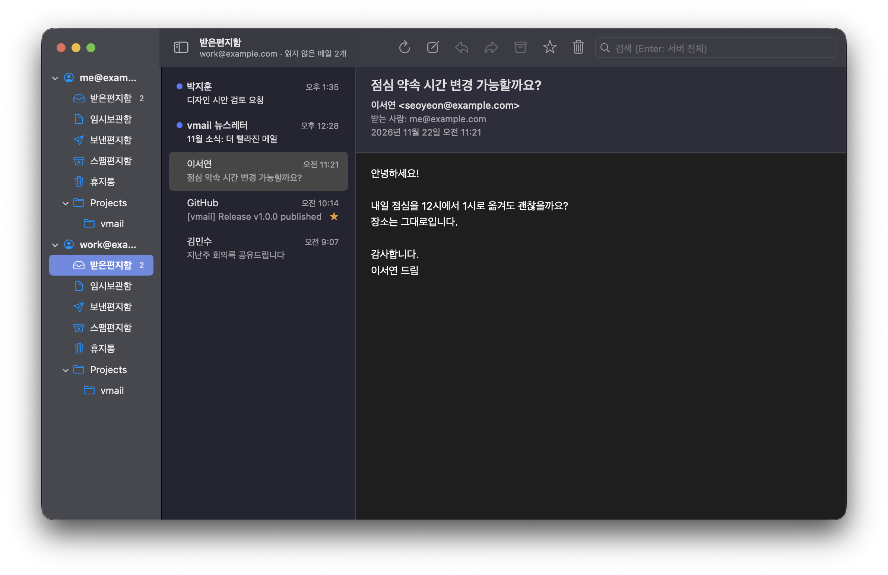

# vmail

macOS용 빠르고 단순한 네이티브 메일 앱. AppKit + 시스템 프레임워크만 사용하고, IMAP/SMTP·MIME 처리를 직접 구현해 외부 의존성이 없습니다.



## 기능

- 3단 레이아웃: 계정별 사서함 트리 · 메시지 목록 · 본문
- 여러 계정 (설정 › 계정에서 추가·수정·제거)
- IMAP 수신 (TLS / STARTTLS), SMTP 발신 (465 TLS / 587 STARTTLS)
- 새 메일, 답장, 모두에게 답장, 전달, 숨은 참조, 서명, 파일 첨부, 임시 저장
- 읽음/읽지 않음, 깃발, 삭제, 보관, 스팸, 사서함 간 이동(메뉴·드래그)
- 대화로 묶기(개수 배지·←/→ 로 펼치기), 목록 본문 미리보기(없음/1줄/2줄)
- 목록 즉시 필터 + Enter로 서버 전체 검색, 읽지 않은 메일만 보기
- 폴더 만들기·이름 변경·삭제, 모두 읽음, 휴지통 비우기
- 규칙(자동 분류): 보낸 사람·제목 등에 글자가 포함되면 이동·읽음·깃발·삭제
- 부재중 자동 응답 (기간 지정, 같은 사람에게 4일에 한 번, 뉴스레터·자동 발송 제외)
- 서명 여러 개 (새 메일 / 답장·전달 / 부재중 응답별 지정, 작성 창에서 전환)
- 설정: 글꼴 및 색상, 보기, 작성 옵션 (삭제 위치, 읽음 처리, 발송 취소 대기 등)
- 설정 내보내기·가져오기 (계정·규칙·서명 등, 비밀번호 제외)
- 새 메일 알림, mailto: 링크, 프린트, 원본(.eml) 저장, 본문 확대/축소
- HTML 메일 렌더링 — 스크립트 비활성화, 원격 이미지 기본 차단
- 첨부 파일 열기 / 다운로드 폴더에 저장
- 한국어 레거시 인코딩(EUC-KR, CP949) 지원
- 목록 디스크 캐시로 실행 즉시 표시, 60초마다 자동 새로 고침, Dock 배지

## 계정

이메일 주소를 입력하면 서버 설정이 자동으로 채워집니다 (Gmail, 네이버, 다음, 카카오, iCloud, Yahoo).

- Gmail · iCloud 등 2단계 인증 계정은 **앱 비밀번호**가 필요합니다. 시트의 ‘앱 비밀번호 발급 페이지 열기’ 버튼으로 바로 이동할 수 있습니다.
- ‘키체인에서 가져오기’는 다른 메일 앱이 로그인 키체인에 저장해 둔 IMAP 비밀번호를 불러옵니다. OAuth로 로그인한 계정(Apple Mail의 Gmail 등)은 비밀번호가 존재하지 않아 가져올 수 없습니다.
- 비밀번호는 이 Mac의 키체인에만 저장됩니다.

## 프라이버시

- **중간 서버 없음** — Mac이 메일 서버(IMAP/SMTP)에 직접 접속합니다. vmail에는 서버도, 가입도 없습니다.
- **비밀번호는 키체인에만** — 이 Mac의 키체인에만 저장되고 설정 내보내기에도 포함되지 않습니다.
- **추적·분석 없음** — 사용 통계, 광고, 텔레메트리가 없습니다.
- **열람 추적 차단** — HTML 메일의 스크립트는 끄고 원격 이미지는 기본으로 막습니다.

## 설치

```bash
brew install --cask seongilp/tap/vmail
```

또는 [Releases](https://github.com/seongilp/vmail/releases/latest)에서 DMG를 내려받아 응용 프로그램 폴더로 옮깁니다. Developer ID 서명 및 Apple 공증을 거쳤습니다.

## 명령줄 도구 (vmail CLI)

Homebrew로 설치하면 `vmail` 명령이 함께 설치됩니다. 앱에 등록한 계정을 그대로 씁니다.

```bash
vmail list --unread                  # 받은편지함의 읽지 않은 메일
vmail search "회의" -n 10             # 서버 전체 검색
vmail read 1234                      # 본문 읽기 (--json, --raw, --attachments 폴더)
vmail mark 1234 --read               # 읽음 / --unread / --flag / --unflag
vmail move 1234 --dest all           # 사서함 이동 (이름 또는 inbox·sent·trash·junk·all)
vmail delete 1234                    # 휴지통으로
echo "본문" | vmail send --to a@example.com --subject "제목"   # --dry-run 으로 미리 확인
vmail doctor                         # 계정별 키체인·로그인 점검
```

- 모든 명령에 `--json`을 붙이면 기계가 읽기 좋은 출력이 나옵니다. 종료 코드는 0(성공), 1(실행 오류), 64(사용법 오류)입니다.
- 처음 실행하면 macOS가 키체인 접근을 묻습니다. 계정마다 한 번 ‘항상 허용’을 누르면 됩니다 (`vmail doctor`로 한 번에 처리).
- **AI 에이전트에서 쓰기**: `vmail install-skill`이 Claude Code(`~/.claude/skills/vmail`)와 Codex(`~/.codex/skills/vmail`)에 스킬을 설치합니다. 안내문만 보려면 `vmail agent-guide`.

## 후원

vmail은 무료 오픈 소스입니다. 도움이 되었다면 [후원](https://ko-fi.com/seongilp)으로 응원해 주세요.

## 빌드

Xcode 프로젝트 없이 SwiftPM으로 빌드합니다. macOS 13 이상.

```bash
./build.sh                    # 릴리스 빌드 → vmail.app 조립 → 서명
open -a "$(pwd)/vmail.app"
swift test                    # 단위·프로토콜 테스트
VMAIL_NET=1 swift test        # 실제 서버와 TLS 핸드셰이크까지 확인
```

## 구조

```
Sources/MailCore/   프로토콜·파싱 (UI 의존성 없음)
  LineConnection    줄 단위 소켓 (TLS, STARTTLS 승격, 타임아웃)
  IMAPClient/Parser IMAP4rev1 클라이언트와 응답 파서
  SMTPClient        메시지 발송
  MIMEParser        헤더·multipart·전송 인코딩
  ParsedMessage     화면 표시용 메시지 해석
  MessageBuilder    보낼 메시지 조립
  MailSession       백그라운드 큐에서 연결 관리·재시도
Sources/vmail/      AppKit UI
```

## 단축키

| 동작 | 키 |
| --- | --- |
| 새로운 메일 | ⌘N |
| 메일 가져오기 | ⌘R |
| 답장 / 모두에게 답장 / 전달 | ⇧⌘R / ⌥⌘R / ⇧⌘F |
| 보관 / 스팸으로 이동 | ⌃⌘A / ⇧⌘J |
| 임시 저장 | ⌘S |
| 보내기 | ⇧⌘D 또는 ⌘↩ |
| 읽음 전환 / 깃발 | ⇧⌘U / ⇧⌘L |
| 삭제 | ⌫ |
| 검색 | ⌘F |
| 설정 | ⌘, |
